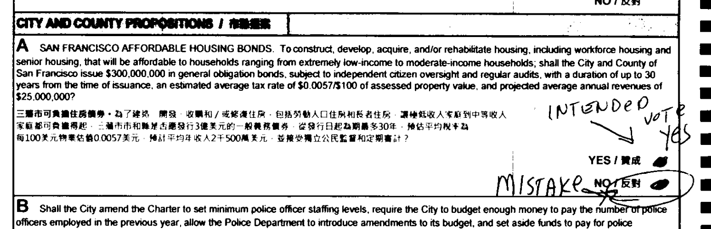

# SF Vote Correlator

This is a project intended to reveal correlations between votes in San Francisco using the [cast vote records (CVRs)](https://en.wikipedia.org/wiki/Cast_vote_record)
that the San Francisco Department of Elections releases to the public every election.

## About CVRs

These CVRs released to the public are essentially JSON-encoded logs that describe the process of scanning each ballot card: what marks were detected, which were ambiguous, and what the vote result is. These files also contains data that was modified by an election worker later: for example, if a voter makes a mistake, scratches it out and writes something like "mistake, meant to vote yes," the machine may read this as an "overvote" and it may be corrected later using voter intent. Here is an example of one such ballot:

## How is this different than other election-results explorers?

While other sites and news organizations focus on displaying the overall results and correlating these by precinct
(and other data about each precinct from sources like the U.S. Census), this project is intended to reveal
correlations _within ballots_ using data uniquely available from the CVR.

## How does it work?

The script in `election_data/` allows you to parse CVRs into a JSON format designed to tally correlations. (See [the README within that directory](election_data/README.md) for more details.) This JSON can then be imported by the React application to allow users to explore correlations in the applicable election.

## Pending follow-ups

Currently, races that use ranked-choice voting or multiple candidates are not supported. Additionally,
I noticed that some CVR entries in June 2026 are marked as "redacted" although ballot-image data is still
available for these. This sums to a total of less than 30 votes and so does not greatly impact the result,
so for now I simply display a warning on elections like these with missing data.

## A note on AI usage

Most of this is coded by hand, but I used AI for some of the styling on the frontend. Code written by AI is confined to git commits with "\[AI\]" prepended to the commit message.